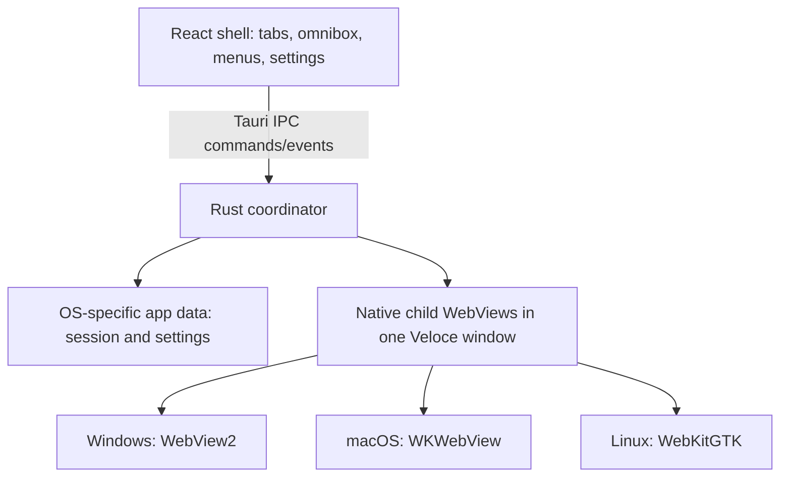

# Veloce architecture and release criteria

## Runtime layers

The shell owns navigation chrome and overlays. Native page WebViews are children of the same Tauri window and are sized below the shell. The Rust command layer is the authority for tab IDs, active-tab state, URL normalization and zoom. Web content cannot create a separate Veloce window: supported HTTP/HTTPS popups are forwarded to the tab coordinator.

## Current resource policy

Only the active tab is created on session restore; other restored tabs remain URL metadata until selected. A one-shot timer in the shell asks Rust to discard a tab that has been inactive for the configured duration. Rust verifies that the tab is still background and unpinned before closing its native WebView. A return to that tab creates a new WebView and navigates to its recorded URL. This releases the view object and page runtime, but it is not browser-style process freezing: in-memory page state is lost and the OS engine may retain shared processes/cache. A hard RSS cap is intentionally absent because forcibly killing engine processes can lose data or crash tabs.

The Gaming profile only reduces background-page lifetime. The active WebView remains unthrottled by Veloce; fullscreen, WebGL and WebGPU remain delegated to the system WebView. The app does not alter OS power plans, GPU policies, or process priorities.

## Privacy boundary

The current Rust tracker rule runs before a **top-level navigation** proceeds. It does not see or block subresource requests, service workers, DNS, cookies, or tracker scripts embedded in a normal page. A production content blocker needs engine-specific request adapters and separately maintained filter lists:

| Platform | Embedded engine | Production subresource filter work |
|---|---|---|
| Windows | WebView2 / Chromium | WebView2 resource-request event adapter, redirect/response policy, lifecycle and filter-list updates |
| macOS | WKWebView / WebKit | WebKit content-rule lists with compiled, versioned rule assets |
| Linux | WebKitGTK | WebKitGTK content-filter API and distribution/version capability checks |

The Chrome Web Store depends on Chromium extension APIs that are not part of WKWebView or WebKitGTK. A one-click Chrome Web Store promise is therefore incompatible with this system-WebView architecture. Supporting it would require a Chromium/CEF runtime across all supported OSes, its security-update pipeline, and extension-policy review. This baseline deliberately has no fake “installed” status.

Passwords require a separate security design and OS-backed secret storage (Windows Credential Manager/DPAPI, macOS Keychain, Linux Secret Service/libsecret), threat-model review, migration/backup behavior, and security tests. No plaintext or demo password vault is included. SponsorBlock also requires a clearly disclosed connection to its service and opt-in handling of video IDs; that feature is not included in this baseline.

## Performance validation before release

Report cold start, idle CPU/RSS, active-site CPU/RSS, and memory after ten representative tabs. Record OS, hardware, native WebView versions, sites, wait period, extension/filter state, and whether renderer/GPU processes are included. On Windows, WebView2 uses a multiprocess browser/renderer/GPU model, so a single Veloce process figure is incomplete. Microsoft recommends measuring the full WebView2 process group and avoiding redundant controls; each control can add process and startup overhead ([process model](https://learn.microsoft.com/en-us/microsoft-edge/webview2/concepts/process-model), [performance guidance](https://learn.microsoft.com/microsoft-edge/webview2/concepts/performance)). Use Instruments on macOS and the platform's process/WebKit profiling tools on Linux. Do not publish fixed memory, startup or FPS promises without reproducible target-hardware measurements.

## Release gates

1. Build and run separately on Windows, macOS and at least one supported Linux distribution.
2. Verify navigation, native window controls, child-view geometry, DPI/display scaling, popup routing, zoom shortcuts and fullscreen on each engine.
3. Verify site isolation, WebView process failure recovery, session corruption handling, download paths and secure deletion behavior.
4. Integrate and audit each platform's subresource filter before describing Veloce as an ad blocker.
5. Complete a threat model, OS secret-store integration, dependency audit and security review before shipping any password feature.
6. Measure the resource scenarios above on minimum-spec and mainstream hardware. Keep targets advisory unless a safe engine-level policy can enforce them without data loss.
